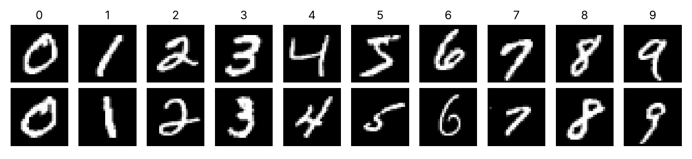
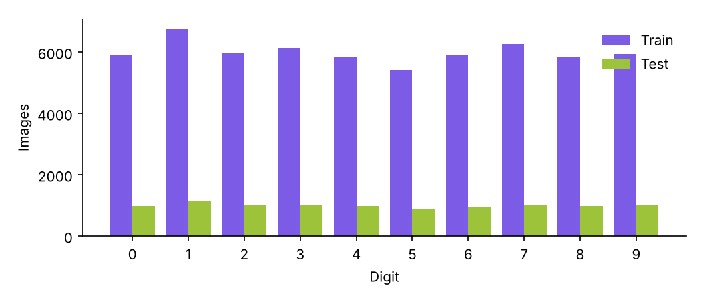
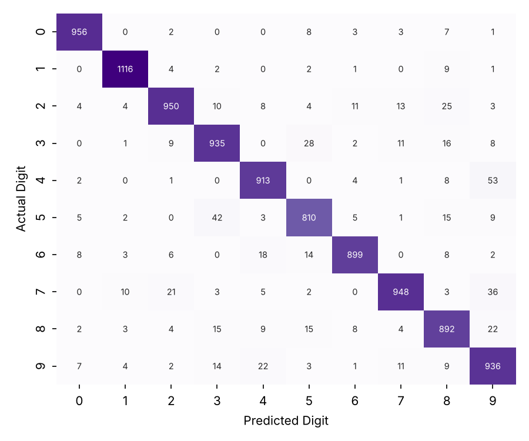
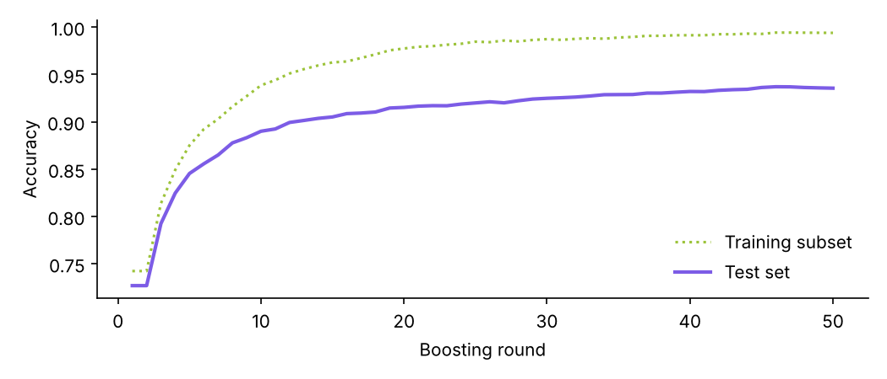
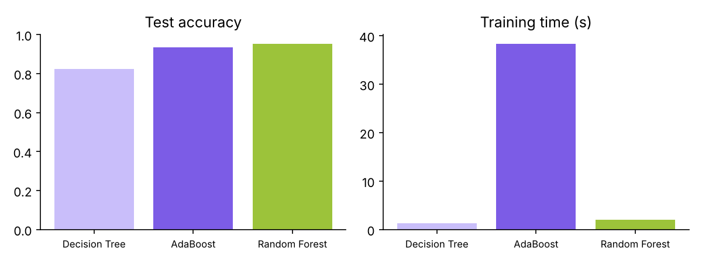
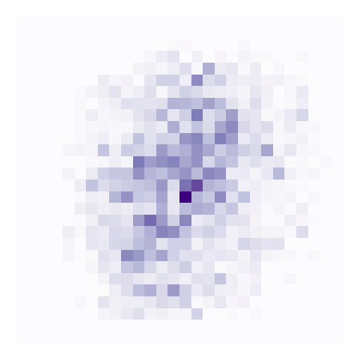

# Classify Handwritten Digits (MNIST) Using AdaBoost

**Machine Learning Mini-Project Report**  
**Submitted by:** Shravani Yalagatti  
**Institute:** Department of CSBS, JSPM's RSCOE, Pune  
**Date:** 26 October 2026

---

## 1. Abstract

This project builds an interactive system that recognises handwritten digits using the AdaBoost ensemble algorithm with decision-tree weak learners. Trained on 10,000 MNIST images, 50 boosted trees of depth 6 reached **93.55% accuracy** and a macro F1-score of 93.49% on the official 10,000-image test set, compared with 72.64% for a single tree of the same depth. A Streamlit dashboard lets users draw digits, tune hyper-parameters, inspect the data, compare AdaBoost with Decision Tree and Random Forest, and follow a manual AdaBoost calculation.

## 2. Introduction

Handwritten digit recognition is used for postal codes, bank cheques and form digitisation. It is a standard benchmark for classification algorithms because handwriting varies widely between people. Ensemble methods combine many simple models into a stronger one; AdaBoost is the classic boosting algorithm.

## 3. Problem Statement

Given a 28 × 28 grayscale image of a single handwritten digit, predict which digit (0–9) it shows, using AdaBoost as the primary classifier, and evaluate how well it generalises to handwriting it has never seen.

## 4. Objectives

- Understand and validate the MNIST dataset.
- Build a reproducible preprocessing pipeline.
- Implement and tune multiclass AdaBoost with decision-tree weak learners.
- Demonstrate AdaBoost's weight updates through a manual calculation.
- Evaluate with accuracy, precision, recall, F1 and a confusion matrix.
- Compare AdaBoost with Decision Tree and Random Forest under identical conditions.
- Deliver an interactive dashboard with live digit prediction.

## 5. Dataset Description

MNIST contains 70,000 grayscale images of handwritten digits (28 × 28 = 784 pixels, values 0–255) with the official split of **60,000 training** and **10,000 test** images. **Features:** the 784 pixel intensities. **Target:** the digit label 0–9 (10 classes).

| Digit | 0 | 1 | 2 | 3 | 4 | 5 | 6 | 7 | 8 | 9 |
|---|---|---|---|---|---|---|---|---|---|---|
| Train | 5,923 | 6,742 | 5,958 | 6,131 | 5,842 | 5,421 | 5,918 | 6,265 | 5,851 | 5,949 |
| Test | 980 | 1,135 | 1,032 | 1,010 | 982 | 892 | 958 | 1,028 | 974 | 1,009 |

Validation (computed): pixel range 0–255; missing values: 0; exact duplicate training images: 0; images present in both train and test: 0.



*Figure: Sample training images (two per digit)*



*Figure: Class distribution in the training and test sets*

## 6. Tools and Technologies

Python · scikit-learn (AdaBoostClassifier, DecisionTreeClassifier, RandomForestClassifier, metrics) · NumPy · Pandas · Streamlit (web app, session state, navigation) · Plotly (interactive charts) · Matplotlib/Seaborn (report figures) · Pillow & SciPy (image preprocessing) · streamlit-drawable-canvas (drawing input) · Joblib (model persistence) · pytest (automated tests).

## 7. Data Preprocessing

1. **Loading** the official 60,000/10,000 split (local cache with online fallbacks).
1. **Validation**: shapes, label set, pixel range, missing values (none found) and duplicate checks.
1. **Normalisation**: pixel / 255 → values in [0, 1]. A fixed transform, so no information leaks from the test set.
1. **Flattening**: each 28 × 28 image → a 784-feature vector, because scikit-learn expects a 2-D samples × features table.
1. **Stratified subsampling** of the training set (keeps each digit's proportion) to keep AdaBoost fast.
1. **Fixed random seed** for reproducible subsets and models.
1. **User drawings**: grayscale → invert if needed → crop to the digit → resize longest side to 20 px (aspect kept) → centre in 28 × 28 by centre of mass → normalise.

## 8. AdaBoost Theory

AdaBoost (Adaptive Boosting) trains weak learners sequentially. Each training sample has a weight; after each round, misclassified samples receive more weight so the next learner focuses on them. Each learner gets a vote α based on its weighted error ε, and the final prediction is the weighted vote. For K classes scikit-learn uses SAMME: α = η·[ln((1−ε)/ε) + ln(K−1)], and misclassified sample weights are multiplied by e^α.

## 9. Manual AdaBoost Calculation

Binary example with six samples (labels −1/+1), N = 6, initial weights 1/6 ≈ 0.1667.

| Round | Learner | ε | α | Weights after (x1…x6) |
|---|---|---|---|---|
| 1 | h1: hours > 2.5 | 0.1667 | 0.8047 | 0.1000, 0.1000, 0.1000, 0.5000, 0.1000, 0.1000 |
| 2 | h2: hours > 4.5 | 0.1000 | 1.0986 | 0.0556, 0.0556, 0.5000, 0.2778, 0.0556, 0.0556 |
| 3 | h3: hours is odd | 0.1111 | 1.0397 | 0.2500, 0.0312, 0.2812, 0.1562, 0.0312, 0.2500 |

Round 1 worked: ε₁ = 1/6 = 0.1667; α₁ = ½·ln((1−0.1667)/0.1667) = ½·ln 5 = 0.8047. Correct samples are multiplied by e^−α = 0.4472, the wrong one by e^α = 2.2361; after normalising, correct samples have weight 0.1000 and the misclassified sample 0.5000.

Final vote H(x) = sign(Σ αₜhₜ(x)) gives scores -0.864, -2.943, 0.746, -1.334, 2.943, 0.864 → ensemble accuracy **100%**, although each weak learner alone makes mistakes.

*This binary example is educational and separate from the multiclass MNIST model.*

## 10. System Architecture

```
MNIST data ──► src/data_loader (load + validate)
        │
        ▼
src/preprocessing (normalise, flatten, subsample, user-image pipeline)
        │
        ▼
src/model_training ──► src/adaboost_model (AdaBoost + tree weak learners) ──► models/*.joblib
        │
        ▼
src/evaluation · src/comparison · src/manual_adaboost · src/report
        │
        ▼
ui/ (state, styling, components) ──► views/ (11 Streamlit pages) ──► app.py (navigation)
```

## 11. Implementation Methodology

The ML code (`src/`) is independent of the user interface and covered by automated tests. The Streamlit app caches the dataset, saves every trained model with its configuration and measured metrics, reuses a saved model when the same configuration is requested again, and logs every experiment for comparison.

## 12. Hyperparameter Configuration

| Parameter | Value | Meaning |
|---|---|---|
| n_estimators | 50 (50 fitted) | number of boosting rounds |
| learning_rate | 0.5 | shrinks each learner's vote |
| max_depth (weak learner) | 6 | strength of each tree |
| training images | 10,000 | stratified subset |
| random_state | 42 | reproducibility |

Logged experiments (measured):

| # | Estimators | Depth | LR | Train size | Test acc. | Time (s) |
|---|---|---|---|---|---|---|
| 1 | 50 | 6 | 0.5 | 10,000 | 93.55% | 41.7 |
| 2 | 30 | 4 | 0.5 | 5,000 | 87.46% | 7.6 |
| 3 | 50 | 1 | 0.5 | 10,000 | 63.69% | 7.3 |
| 4 | 50 | 8 | 0.5 | 10,000 | 94.85% | 51.2 |
| 5 | 100 | 10 | 0.5 | 10,000 | 96.02% | 120.4 |

## 13. Model Evaluation

| Metric | Macro | Weighted |
|---|---|---|
| Precision | 93.54% | 93.61% |
| Recall | 93.47% | 93.55% |
| F1-score | 93.49% | 93.56% |

**Accuracy:** 93.55% (9,355/10,000). **Training time:** 41.7 s. **Inference:** 0.0199 ms per image.

| Digit | Precision | Recall | F1 | Support |
|---|---|---|---|---|
| 0 | 0.972 | 0.976 | 0.974 | 980 |
| 1 | 0.976 | 0.983 | 0.980 | 1135 |
| 2 | 0.951 | 0.921 | 0.935 | 1032 |
| 3 | 0.916 | 0.926 | 0.921 | 1010 |
| 4 | 0.934 | 0.930 | 0.932 | 982 |
| 5 | 0.914 | 0.908 | 0.911 | 892 |
| 6 | 0.963 | 0.938 | 0.950 | 958 |
| 7 | 0.956 | 0.922 | 0.939 | 1028 |
| 8 | 0.899 | 0.916 | 0.907 | 974 |
| 9 | 0.874 | 0.928 | 0.900 | 1009 |



*Figure: Confusion matrix on the 10,000 test images*



*Figure: Accuracy after each boosting round*

## 14. Algorithm Comparison

All models used the same stratified training subset and the full test set.

| Model | Accuracy | Macro P | Macro R | Macro F1 | Train (s) | Inference (s) |
|---|---|---|---|---|---|---|
| Decision Tree | 82.32% | 82.13% | 82.06% | 82.06% | 1.34 | 0.008 |
| AdaBoost | 93.55% | 93.54% | 93.47% | 93.49% | 38.32 | 0.196 |
| Random Forest | 95.13% | 95.12% | 95.08% | 95.09% | 2.07 | 0.122 |



*Figure: Model comparison*

Results depend on the training subset, hyper-parameters, random seed and hardware.

## 15. Visualizations

The dashboard provides: digit galleries, class-distribution charts, pixel-intensity heatmaps, average digit images, an interactive confusion matrix with cell inspection, staged-accuracy and α/ε charts, a pixel feature-importance map, model-comparison bar charts, prediction score charts, and manual-AdaBoost weight charts.



*Figure: Pixels AdaBoost relies on most (feature importance)*

## 16. Results and Discussion

- AdaBoost improved test accuracy from 72.64% (single tree) to 93.55%, confirming that boosting weak learners builds a strong classifier.
- Training accuracy 99.39% vs test 93.55%: a gap of 5.8%.
- Easiest digit: Digit 1 (F1 0.980); hardest: Digit 9 (F1 0.900).
- Most frequent confusions: 4→9 (53); 5→3 (42); 7→9 (36); 3→5 (28). These pairs share many pixels (e.g. 4/9 differ mainly by a closed top).
- Accuracy rises quickly over the first boosting rounds and then levels off.

## 17. Limitations

- Pixel-based trees ignore 2-D structure: shifted, rotated or unusually thick/thin digits are misread.
- AdaBoost trains sequentially and slows down with large training sets or deep trees.
- Sensitive to noisy or mislabelled training samples (they receive ever-larger weights).
- Mouse-drawn digits differ from scanned pen strokes, so live accuracy can be lower than test accuracy.
- The weighted vote share shown with a prediction is not a calibrated probability.

## 18. Conclusion

AdaBoost with shallow decision trees is an effective and interpretable approach to handwritten digit recognition, far exceeding a single tree. The interactive application makes every stage — data, preprocessing, training, evaluation, comparison and the algorithm's mathematics — visible and reproducible.

## 19. Future Scope

- Feature engineering (HOG, PCA) to give trees shape-aware inputs.
- Probability calibration (CalibratedClassifierCV) for meaningful confidence values.
- Data augmentation (shifts/rotations) to improve robustness to drawing style.
- Gradient boosting (XGBoost/LightGBM) and a CNN baseline for comparison.
- Deploying the app online for public use.

## 20. References

1. Y. LeCun, C. Cortes, C. J. C. Burges — The MNIST database of handwritten digits.
1. Y. Freund, R. E. Schapire (1997) — A decision-theoretic generalization of on-line learning and an application to boosting. Journal of Computer and System Sciences, 55(1).
1. J. Zhu, H. Zou, S. Rosset, T. Hastie (2009) — Multi-class AdaBoost. Statistics and Its Interface, 2(3).
1. F. Pedregosa et al. (2011) — Scikit-learn: Machine Learning in Python. JMLR 12.
1. Streamlit and Plotly documentation.
